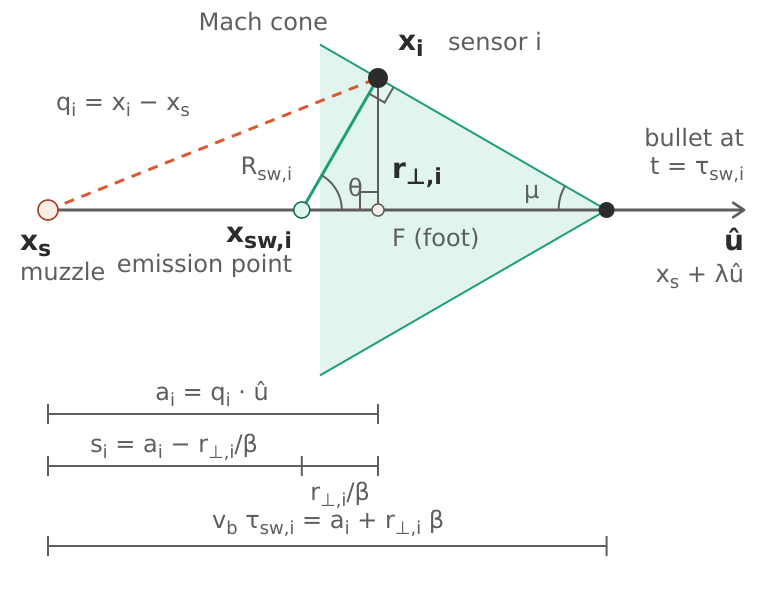
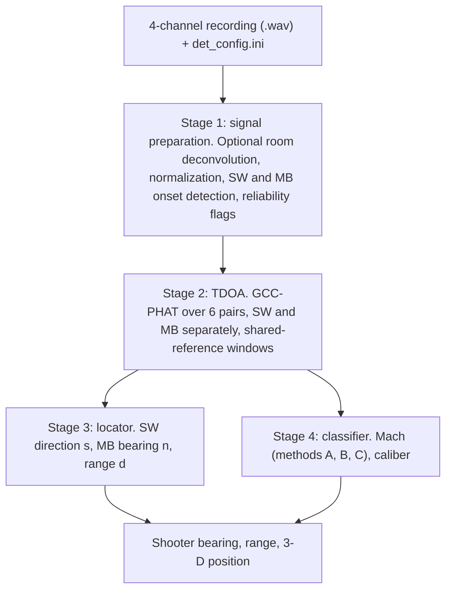
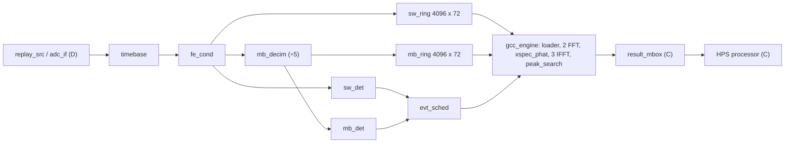

# Two-Event Acoustic Gunshot Detection and Shooter Localization with a Single Tetrahedral Array: Algorithms and Real-Time FPGA Architecture

> **Draft status.** Companion to Paper 1 (`Paper-Generator.md`), which covers signal generation. This paper covers the detection side of the repository at commit `7b8a632`: the Python reference detector (`python/gs_det_*.py`) and the FPGA implementation (`verilog/`).
> **Simulation results** in Section 7 are transcribed from the repository's verification logs (`verilog/gcc_engine/readme.md`, `verilog/stream/readme.md`, `verilog/timing_budget.md`, `python/drag_model.md`). Regenerate them from a tagged commit before submission.
> **No real-recording result has been measured.** Those values are written as `[ ]`. Items marked **TODO** need action. See the checklist at the end (delete before submission).

---

Author : Rizki Ardianto (edes) ;   Denny Darlis ;   Saladin Prawirasastra (bibin)

Telkom University, Bandung, Indonesia

> **TODO:** confirm the author list and order for this paper.

---

## Abstract

A supersonic gunshot produces two acoustic events at a remote sensor: the ballistic shockwave (SW), radiated from the projectile's Mach cone, and the muzzle blast (MB), radiated from the weapon. A single compact microphone array that measures the propagation direction of both events and the delay between them can estimate the shooter's bearing and range. This paper presents the detection side of an open gunshot-locator design built around a four-microphone tetrahedral array with 0.30 m edges. It comprises a blind four-stage reference detector in Python and a real-time FPGA implementation of its time-critical part for a Cyclone V system-on-chip.

The reference detector finds SW and MB onsets, estimates six pairwise time differences of arrival (TDOAs) per event with GCC-PHAT using shared-reference windowing, solves plane-wave propagation directions for both events, estimates range from the SW-to-MB delay, and estimates Mach number and caliber by three methods. We show that the scalar range equation used in the reference implementation is algebraically identical to the vector form $d = c\,\Delta t/(1 - \hat{\mathbf{m}}\cdot\hat{\mathbf{s}})$ used in the PILAR system, which requires neither the Mach number nor the miss distance, and we give its conditioning and validity bracket.

The FPGA design processes four channels at 100 kHz continuously. It qualifies shockwave candidates by N-wave symmetry, duration and margin tests, masks overlapping events in both directions, and computes all six correlations of an event with two forward and three inverse 2048-point FFTs in 0.65 ms. It was verified bit-exact against Python models in simulation, driven by a physics-based generator under a strict rule that keeps detector computations independent of generator parameters. Over 15 scenarios from 50 to 1500 m, including bullet drag, a subsonic arrival, four model-mismatch cases and a 900 rpm burst, the fixed-point TDOA error was at most 0.2 µs, per-pair TDOA errors were 2–7 µs for the shockwave and 4–12 µs for the muzzle blast, and muzzle-blast bearing errors were at most 0.60° in azimuth and 0.75° in elevation. The exception was a 13 dB blast signal-to-noise ratio, where one blast pair was 101 µs off and the elevation error reached 2.0°, still inside a ±5° target. The design uses about 19.8k LUTs, 133 M10K blocks and 32 hardware multipliers (indicative synthesis). Simulation also shows that with bullet deceleration the constant-speed range formula overestimates range by up to 118 % for 5.56 mm at 800 m even with perfect inputs, so range accuracy is limited by ballistics rather than timing. Validation on real recordings is `[ ]`.

**Keywords:** gunshot localization, shooter localization, acoustic array, time difference of arrival, GCC-PHAT, ballistic shockwave, muzzle blast, FPGA, real-time signal processing, direction of arrival

---

## 1. Introduction

Acoustic gunshot detection and localization systems are used for force protection, counter-sniper operations, and urban public safety [1]–[3]. Their appeal is that they are purely passive and inexpensive to produce, and that a single gunshot carries enough acoustic information to estimate where it came from.

A supersonic projectile produces two distinct acoustic events [4]. The **ballistic shockwave** is generated continuously along the trajectory by the projectile's Mach cone. It arrives first, carries most of its energy at high frequency in an N-shaped pressure signature [5], [6], and propagates in a direction fixed by the trajectory and the Mach number. The **muzzle blast** is generated by propellant gases at the muzzle. It arrives later, carries most of its energy below about 500 Hz at ranges of hundreds of metres [4], and propagates from the shooter's position. A compact array that measures the propagation direction of each event and the delay between them can therefore estimate the shooter's bearing from the blast and the range from the delay. This principle underlies the PILAR system [4], the BBN counter-sniper and Boomerang systems [7], [8], and their successors.

Other architectures distribute single-microphone nodes over an area and fuse shockwave and blast detections across the network [9], [10]. Sensitivity analysis and calibration of such systems have been studied by Akman *et al.* [11], [12]. On the hardware side, FPGA implementations of real-time sound-source localization with phase-transform cross-correlation and beamforming have been reported for general acoustic sources [13], [14]. At Telkom University, an earlier gunshot-direction study used FIR filtering and TDOA estimation to determine the direction of a gunshot [15], and gunshot detection systems combining detection, localization and classification continue to be reported [16].

Published descriptions of complete systems typically report either the algorithm or the field performance. Few connect the localization equations, the onset detectors, a fixed-point real-time implementation and an error budget in one openly reproducible design. Commercial systems publish performance tables but not their processing [4], [8].

This paper describes such a design. It is the companion to Paper 1 [17], which presents the physics-based generator used here as the "world" against which the detector is tested. The contributions are:

1. a blind four-stage reference detector with explicit reliability flags (muzzle-blast reliability, shockwave consistency, slowness magnitude, TDOA closure), and the shared-reference windowing requirement for windowed GCC-PHAT;
2. an analysis of the single-array range equation: the algebraic equivalence of the scalar form in Mach number and miss distance with the PILAR vector form, its conditioning, and its validity bracket;
3. a real-time FPGA architecture for continuous four-channel detection and GCC-PHAT, with design additions derived from simulation: N-wave qualification of shockwave candidates, held and latched muzzle-blast detection, and event masks in both directions;
4. a verification methodology that separates generator and detector, includes deliberate model-mismatch scenarios, and checks every hardware block bit-exact against a Python model; and
5. a timing and error budget linking per-pair TDOA error, analog front-end design and ADC choice to bearing and range accuracy, and a quantification of bullet deceleration as the dominant range-error term.

Signal generation is covered in Paper 1. The processor software (Milestone C) and the hardware front end (Milestone D) are presented as designs and budgets; they are not yet built. Section 2 gives the measurement principle, Section 3 the reference detector, Section 4 the real-time architecture, Section 5 the error budget, Section 6 the evaluation method, Section 7 the results, Section 8 the discussion, Section 9 limitations and future work, and Section 10 concludes.

---

## 2. Measurement Principle

### 2.1 Array Geometry and Conventions

The array is a regular tetrahedron with edge length $L = 0.30$ m. Its microphone positions $\mathbf{p}_0,\dots,\mathbf{p}_3$ are the scaled vertices

$$
\mathbf{p}_i = \frac{L}{\ell}\,\mathbf{v}_i, \quad
\mathbf{v}_0 = (0,\ 0,\ 1),\ \
\mathbf{v}_1 = (0,\ 0.943,\ -0.333),\ \
\mathbf{v}_2 = (-0.816,\ -0.471,\ -0.333),\ \
\mathbf{v}_3 = (0.816,\ -0.471,\ -0.333),
$$

with $\ell = \lVert\mathbf{v}_0 - \mathbf{v}_1\rVert$, so the array is centred on the origin with microphone 0 at the apex. The circumradius is 0.184 m. The largest possible pair TDOA is $L/c = 875$ µs at $c = 343$ m/s.

The six pairs are ordered $(0,1), (0,2), (0,3), (1,2), (1,3), (2,3)$. For pair $(a,b)$ the TDOA is

$$
\tau_{ab} = t_b - t_a ,
$$

so a positive value means that microphone $b$ receives the wavefront later. The same convention is used in the Python code, the RTL and the bit-true models.

### 2.2 Two-Event Model

Paper 1 [17] gives the waveform and arrival-time models in detail; only the directional relations are needed here. Let $\hat{\mathbf{t}}$ be the unit bullet direction, $M = v/c$ the Mach number, $\hat{\mathbf{s}}$ the unit propagation direction of the shockwave at the array, and $\hat{\mathbf{m}}$ the unit propagation direction of the muzzle blast at the array (pointing from the shooter towards the array). The shock ray leaves the trajectory at the Mach angle, so [4], [5]

$$
\hat{\mathbf{t}}\cdot\hat{\mathbf{s}} = \frac{1}{M}.
$$

The blast is a spherical wave from the muzzle, so the shooter direction seen from the array is $\hat{\mathbf{n}} = -\hat{\mathbf{m}}$. For a supersonic bullet the shockwave reaches the array first (Paper 1, Section 3.2), and the measured delay is

$$
\Delta t = t_{\mathrm{mb}} - t_{\mathrm{sw}} \ge 0 .
$$

### 2.3 Plane-Wave Direction Estimation

Each TDOA constrains the source to one sheet of a hyperboloid with the two microphones as foci, and a near-field locator intersects these surfaces [18]. At ranges much larger than the aperture the hyperboloids approach their asymptotic cones, and the arrival-time differences become linear in the propagation direction. For a plane wave with unit propagation direction $\hat{\mathbf{k}}$,

$$
\tau_{ab} = \frac{(\mathbf{p}_b - \mathbf{p}_a)\cdot\hat{\mathbf{k}}}{c}.
$$

Stacking the pairs gives $\mathbf{D}\,\mathbf{k} = c\,\boldsymbol{\tau}$, where row $q$ of $\mathbf{D}$ is $(\mathbf{p}_b - \mathbf{p}_a)^{\mathsf T}$ for pair $q$. Two solutions are used:

- **Square solution (reference detector).** The three pairs that contain a reference microphone $r$ give a $3\times3$ system that is solved exactly.
- **Least squares (FPGA and processor path).** All six pairs give $\hat{\mathbf{k}}_{\mathrm{LS}} = (\mathbf{D}^{\mathsf T}\mathbf{D})^{-1}\mathbf{D}^{\mathsf T} c\,\boldsymbol{\tau}$.

The unnormalized solution $\mathbf{k}$ is a scaled slowness vector. Its magnitude is $c/c_{\mathrm{app}}$, where $c_{\mathrm{app}}$ is the apparent propagation speed across the array, so $\lVert\mathbf{k}\rVert \approx 1$ is a consistency check: a value far from one indicates an inconsistent TDOA set or a wavefront that is not plane. The direction is $\hat{\mathbf{k}} = \mathbf{k}/\lVert\mathbf{k}\rVert$. Because $c$ scales every element of $\mathbf{k}$ equally, an error in the assumed sound speed changes $\lVert\mathbf{k}\rVert$ but not $\hat{\mathbf{k}}$. The 40 °C mismatch scenario in Section 7.2 confirms this.

Applied to the blast, $\hat{\mathbf{n}} = -\hat{\mathbf{k}}_{\mathrm{mb}}$, with

$$
\text{azimuth} = \operatorname{atan2}(n_y, n_x), \qquad \text{elevation} = \arcsin(n_z).
$$

Applied to the shockwave, $\hat{\mathbf{s}} = \hat{\mathbf{k}}_{\mathrm{sw}}$.

**Far-field validity.** We computed the largest difference between the exact spherical-wave TDOA and the plane-wave TDOA over all six pairs and 20,000 random source directions. It is 1.86 µs at 25 m, 0.93 µs at 50 m, 0.23 µs at 200 m and 0.03 µs at 1500 m. Within the 50–1500 m design range the plane-wave error is therefore below 1 µs, an order of magnitude inside the per-pair budget of Section 5. The shockwave front is conical rather than spherical; its curvature across the array grows as the miss distance shrinks.

> **TODO:** quantify the plane-wave error for the conical shockwave front as a function of miss distance, and score the shockwave direction $\hat{\mathbf{s}}$ in Section 7 (currently only the blast bearing is scored).

**Closure.** For any three microphones, $\tau_{ab} + \tau_{bc} - \tau_{ac} = 0$ holds exactly. The residual of each triangle is a model-free check that identifies an outlier pair before the direction is solved.

### 2.4 Range from the Shockwave-to-Blast Delay

Fig. 1 shows the geometry. It is the same as Fig. 2 of Paper 1, with the sensor replaced by the array centre.

**Fig. 1.** Geometry in the plane containing the trajectory and the array (from Paper 1). The muzzle-to-array distance is $d$. The shock that reaches the array is emitted at the detach point, a distance $x$ along the trajectory from the muzzle, and travels a distance $y$ along $\hat{\mathbf{s}}$. In the symbols of Paper 1, $a_i$ is the along-track coordinate $r$ and $r_{\perp,i}$ is the miss distance $b$.

**Vector form.** Following [4], the geometry gives

$$
d\,\hat{\mathbf{m}} = x\,\hat{\mathbf{t}} + y\,\hat{\mathbf{s}},
\qquad
\Delta t = \frac{d}{c} - \left(\frac{x}{v} + \frac{y}{c}\right).
$$

Taking the dot product of the first relation with $\hat{\mathbf{s}}$ and using $\hat{\mathbf{t}}\cdot\hat{\mathbf{s}} = 1/M$ gives $d\,\hat{\mathbf{m}}\cdot\hat{\mathbf{s}} = x/M + y = c\,(x/v + y/c)$. Substituting into the timing relation,

$$
\boxed{\ d = \frac{c\,\Delta t}{1 - \hat{\mathbf{m}}\cdot\hat{\mathbf{s}}}\ }
$$

This needs only the two measured directions and the measured delay. Neither the bullet speed nor the miss distance appears.

**Scalar form.** The reference detector (`gs_det_shooter_locator.py`) instead solves, for the along-track coordinate $r$,

$$
\Delta t = \frac{\sqrt{r^2 + b^2}}{c} - \frac{r + b\beta}{M c}, \qquad \beta = \sqrt{M^2 - 1},
$$

which is the difference of the blast and shock arrival times of Paper 1, and reports $d = \sqrt{r^2 + b^2}$. In the plane of Fig. 1, $\hat{\mathbf{m}} = (r, b)/d$ and $\hat{\mathbf{s}} = (1/M,\ \beta/M)$, so $\hat{\mathbf{m}}\cdot\hat{\mathbf{s}} = (r + b\beta)/(M d)$ and the two forms are **identical**. We verified this numerically over 5000 random geometries ($1.2 \le M \le 3$, $1 \le b \le 50$ m, ranges up to 1500 m); the largest relative difference was $6\times10^{-13}$.

The practical difference lies in the inputs. The scalar form needs estimates of $M$ and $b$. In the reference implementation $M$ comes from the angle-only Method A (Section 2.5) and $b$ from the shockwave amplitude through an assumed absolute calibration of the microphone chain. Both add error that the vector form does not have. The processor design (Section 4.9) therefore uses the vector form.

**Validity bracket.** As a function of $r$, the right-hand side of the scalar equation has its minimum at $r = b/\beta$, which is the Mach-cone boundary $s_i = 0$ of Paper 1. The physical root lies at $r \ge b/\beta$. A root search starting near $r = 0$ brackets a second, non-physical root whenever $c\,\Delta t < b\,(1 - \beta/M)$, that is, at short range relative to the miss distance. The reference implementation searches $[0.1,\ 5000]$ m; in that case the search fails and the stage reports bearing only. In the random test above this happened in 87 of 5000 geometries. It never returned a wrong root.

> **TODO:** start the bracket at $r = b/\beta$ in `pilar_v_exact()`, or replace the scalar solve with the vector form.

**Conditioning.** Writing $\alpha$ for the angle between $\hat{\mathbf{m}}$ and $\hat{\mathbf{s}}$, $d = c\,\Delta t/(1 - \cos\alpha)$ and

$$
\frac{\delta d}{d} \approx \frac{\delta c}{c} \oplus \frac{\delta\Delta t}{\Delta t} \oplus \cot\!\left(\frac{\alpha}{2}\right)\delta\alpha ,
$$

where $\oplus$ denotes root-sum-square combination. Table 1 evaluates the angle term for $\delta\alpha = 1.3°$, the combined error when both directions are at the 10 µs per-pair limit of Section 5.

**Table 1.** Range sensitivity to direction error ($\delta\alpha = 1.3°$) and the corresponding delay.

| $\alpha$ | Angle term | $\Delta t$ at 50 m | $\Delta t$ at 200 m |
|---|---|---|---|
| 90° | 2.3 % | 146 ms | 583 ms |
| 60° | 3.9 % | 73 ms | 292 ms |
| 45° | 5.5 % | 43 ms | 171 ms |
| 30° | 8.5 % | 20 ms | 78 ms |
| 25° | 10.2 % | 14 ms | 55 ms |

Below $\alpha \approx 25°$ the angle term alone exceeds 10 %: the shooter is firing almost along the line to the array, and the equation is ill-conditioned whatever the hardware.

**Constant-speed assumption.** Both forms assume a bullet travelling at constant speed. With deceleration the shock reaching the array is emitted at a lower local Mach number and later than the constant-speed model predicts. Section 7.4 shows that the formula then overestimates range even with perfect inputs.

### 2.5 Mach Number and Caliber

A single array cannot estimate the trajectory unambiguously from the shockwave alone, because the bullet speed is unknown and the cone relation has two solutions in a plane [4]. The blast resolves this. The reference detector (`gs_det_classify_bullet.py`) estimates $M$ in three ways.

**Method A (angle only).** The bullet travels roughly from the shooter towards the array, so $\hat{\mathbf{t}} \approx \hat{\mathbf{m}}$ and

$$
M_A = \frac{1}{\hat{\mathbf{s}}\cdot\hat{\mathbf{m}}}.
$$

It needs no amplitude calibration but is biased: $\hat{\mathbf{t}}$ and $\hat{\mathbf{m}}$ differ by $\alpha_b$, with $\sin\alpha_b = b/d$.

**Method B (duration and amplitude).** For each caliber in the detector's reference library (length $L_b$, reference overpressure $\Delta P_0$ at reference miss distance $b_0$), the measured N-wave peak $\Delta P$ and duration $T_N$ are inverted for $b$ and $M$ using the laws

$$
\Delta P = \Delta P_0\left(\frac{b_0}{b}\right)^{1/2},
\qquad
T_N = \frac{2}{M c}\sqrt{\frac{b\,L_b}{\beta}} .
$$

The first gives $b$ directly; the second is solved for $M \in [1.001, 10]$ by root finding. $\Delta P$ in pascals requires the detector's own assumed full-scale calibration (175 Pa per unit normalized amplitude in `det_config.ini`).

> **TODO (model):** these laws decay as $b^{-1/2}$ and lengthen as $b^{1/2}$. The current generator uses Whitham's far-field asymptotes, $\Delta P \propto (M^2-1)^{1/8} d\, L_b^{-1/4} b^{-3/4}$ and $T_N \propto M d\,(b/L_b)^{1/4}/[c\,(M^2-1)^{3/8}]$ [5] (Paper 1, Section 2.2). The detector need not share the generator's model, but it should either adopt the Whitham laws or state why the $b^{-1/2}$ law is preferred at these miss distances.

**Method C (geometric correction).** Using $b$ and $M_B$ from Method B, the range $r$ is solved with the scalar equation, giving $\sin\alpha_b = b/\sqrt{r^2 + b^2}$. The bullet direction is then rotated away from $\hat{\mathbf{m}}$ by $\alpha_b$ in the plane of $\hat{\mathbf{m}}$ and $\hat{\mathbf{s}}$,

$$
\hat{\mathbf{t}}_C = \cos\alpha_b\,\hat{\mathbf{m}} + \sin\alpha_b\,\hat{\mathbf{e}}, \qquad
\hat{\mathbf{e}} = -\frac{\hat{\mathbf{s}} - (\hat{\mathbf{s}}\cdot\hat{\mathbf{n}})\hat{\mathbf{n}}}{\lVert \hat{\mathbf{s}} - (\hat{\mathbf{s}}\cdot\hat{\mathbf{n}})\hat{\mathbf{n}} \rVert},
$$

and $M_C = 1/(\hat{\mathbf{s}}\cdot\hat{\mathbf{t}}_C)$.

**Caliber.** Method B is run for every caliber in the library. Calibers without a real supersonic root are rejected; among the rest the one whose $M_B$ is closest to 2.25 is reported. The library currently holds two entries (5.56 NATO, $L_b = 23$ mm; 7.62 NATO, $L_b = 28$ mm) that share $\Delta P_0 = 7.5$ Pa at $b_0 = 50$ m, so the discriminating power is small. This stage is a demonstration of the approach, not a validated classifier.

---

## 3. Reference Detector

The reference detector is a four-stage Python pipeline (Fig. 2). It reads one multichannel `.wav` file and its own configuration file, `det_config.ini`, and nothing else. It defines the algorithms that the FPGA implements and is the baseline against which the hardware path is compared.

**Fig. 2.** Reference detector. Stages 3 and 4 depend only on Stage 2 and can run in either order.

### 3.1 Separation Rule

The detector is tested against signals from the generator of Paper 1. To keep the reported accuracy honest, no detector computation may use any generator parameter (Table 2). The rule is enforced in the code structure: the `gs_det_*` modules import nothing from the `gs_gen_*` modules, and constants that both sides need, such as the bullet library, are kept as separate copies.

**Table 2.** Separation between generator, detector and scoring.

| Role | May use | Must never use |
|---|---|---|
| Generator ("the world") | anything | — |
| Detector (Python, RTL, FPGA configuration, processor) | its own configuration, its own code, the signals | generator configuration, generator constants or libraries, ground-truth files |
| Scoring | ground truth, to measure errors | feeding ground truth back into a detector computation |

The detector legitimately knows its own installed geometry, its assumed speed of sound, its thresholds, its own reference library of ammunition types, and its own assumed hardware calibration. It does not know the shooter position, the trajectory, the weapon, the environment, or the generator's hardware model.

> **TODO:** the detector's bullet lengths (23 mm, 28 mm) currently equal the generator's. Replace them with values from an independent published source and test with the generator overriding them.

### 3.2 Stage 1: Onset Detection

Integer PCM input is scaled to $[-1, 1]$. All channels are divided by one common peak so that inter-channel amplitude ratios are preserved.

**Noise floor.** The noise RMS $\sigma$ of each channel is measured over the first $T_{\mathrm{noise}} = 5$ ms of the recording.

**Shockwave onset.** The onset is the first upward crossing of $\lvert x[n]\rvert > K_{\mathrm{sw}}\,\sigma$ with $K_{\mathrm{sw}} = 10$. Because a noise sample can cross the threshold a few samples before the true N-wave rise, the onset is moved to the largest $\lvert x\rvert$ within the next 0.3 ms, the leading peak of the N-wave. The N-wave peak $\Delta P$ is the sample value there, and the duration estimate is twice the time from that peak to the first zero crossing.

**Muzzle-blast onset.** The search for the blast must start after the shockwave's reverberant tail has decayed, but a blind detector cannot know the reverberation time. The detector therefore waits for the signal to settle. Starting 5 ms after the shockwave onset, it moves forward in 1 ms steps until a 5 ms window has RMS below $3\sigma$. The search starts at the later of this point and $t_{\mathrm{sw}} + \Delta t_{\min}$ ($\Delta t_{\min} = 10$ ms) and ends at $t_{\mathrm{sw}} + \Delta t_{\max}$ ($\Delta t_{\max} = 5$ s). Within it, the 1 ms moving mean of $x^2$ is compared with $K_{\mathrm{mb}}\,\sigma^2$, $K_{\mathrm{mb}} = 20$, and the onset is the first upward crossing. If the energy is already above the threshold at the start of the search, the start is reported as the onset and the event is flagged **unreliable**.

**Shockwave consistency.** If the spread of shockwave onsets across channels exceeds three times $L/c$, the detection has probably caught reverberation or noise rather than the wavefront, and the event is flagged.

**Optional room deconvolution.** For a fixed installation, the room or site response can be measured once with a logarithmic sweep (40 Hz–20 kHz, 1 s) played at installation time [19]. Each channel's impulse response $\hat{h}$ is estimated by regularized division,

$$
\hat{H}(f) = \frac{Y(f)\,S^*(f)}{\lvert S(f)\rvert^2 + \lambda\max_f \lvert S(f)\rvert^2}, \qquad \lambda = 0.01,
$$

with $S$ the sweep spectrum and $Y$ the recorded response, and the live signal is deconvolved with the same regularized inverse before onset detection. When deconvolution is applied, Stage 2 replaces GCC-PHAT with direct peak timing (shockwave: −0.1 to +0.5 ms around the onset; blast: +0.5 to +3 ms, because the Friedlander peak follows its onset).

The outputs are a normalized copy of the recording and, per channel, the onset times, $\Delta P$, $T_N$, the blast amplitude, the noise RMS and the reliability flags.

### 3.3 Stage 2: TDOA by GCC-PHAT

For a pair $(a,b)$ with windowed signals $x_a, x_b$, the generalized cross-correlation with phase transform [20], [21] is

$$
\hat{G}_{ab}(f) = \frac{X_b(f)\,X_a^*(f)}{\lvert X_b(f)\,X_a^*(f)\rvert}, \qquad
\hat{\tau}_{ab} = \arg\max_{\lvert\tau\rvert \le \tau_{\max}} \mathcal{F}^{-1}\{\hat{G}_{ab}\}(\tau).
$$

The PHAT weighting whitens the cross-spectrum so that the correlation peak is sharp for impulsive signals [20], [22]. The reference detector interpolates by zero-padding the inverse transform by a factor of 16 and searches $\lvert\tau\rvert \le \tau_{\max} = 1$ ms, which covers the 875 µs geometric limit.

**Shared-reference windowing.** All four channels of an event are windowed around **one** reference time, the onset detected on a reference channel (the lowest-numbered channel with a shockwave and a reliable blast detection). Shockwave windows span 3 ms before to 15 ms after it; blast windows span 6 ms before to 80 ms after. This choice is essential. If each channel were windowed around its own detected onset, the windows would already be shifted by the onset difference $t_b - t_a$, and GCC-PHAT would measure only the residual $\tau_{ab} - (t_b - t_a)$. That residual is close to zero, so the estimator would report $\hat{\tau} \approx 0$ regardless of the true direction.

The six TDOAs of each event, the reference-channel delay $\Delta t$, $\Delta P$ and $T_N$, and the closure residuals are passed to Stages 3 and 4.

### 3.4 Stages 3 and 4

Stage 3 solves $\hat{\mathbf{s}}$ and $\hat{\mathbf{n}}$ with the square solution of Section 2.3, reports $\lVert\mathbf{k}\rVert$ for both, and, if the blast is available and $M_A > 1.01$, estimates range with the scalar equation of Section 2.4. It obtains $b$ from a user-supplied value, from the shockwave amplitude with the library's first caliber, or, as a last resort, a fixed 10 m. The 3-D position is $d\,\hat{\mathbf{n}}$. Stage 4 runs Methods A–C and the caliber test of Section 2.5. Without a reliable blast, both stages report the shockwave direction only.

**Table 3.** Reference detector parameters (`det_config.ini`).

| Group | Parameter | Value |
|---|---|---|
| Geometry | Tetrahedron edge $L$ | 0.30 m |
| Physics | Speed of sound $c$ | 343 m/s |
| Detection | SW threshold $K_{\mathrm{sw}}$ | 10 × noise RMS |
| | MB energy threshold $K_{\mathrm{mb}}$ | 20 × noise power |
| | MB search $[\Delta t_{\min}, \Delta t_{\max}]$ | 10 ms – 5 s |
| | Noise window | 5 ms |
| TDOA | Interpolation factor | 16 |
| | SW window | −3 ms … +15 ms |
| | MB window | −6 ms … +80 ms |
| | Maximum lag | 1 ms |
| Calibration | Assumed peak at full scale | 175 Pa |
| Deconvolution | Sweep, RIR length, $\lambda$ | 40 Hz–20 kHz / 1 s, 2 s, 0.01 (off by default) |

---

## 4. Real-Time Architecture

### 4.1 Platform and Partition

The target is a Terasic DE10-Standard board [23] with a Cyclone V SX system-on-chip (5CSXFC6D6F31C6): FPGA fabric with 41,910 ALMs, 553 M10K memory blocks and 112 DSP blocks, plus a dual-core ARM Cortex-A9 hard processor system (HPS). The fabric runs from a single 100 MHz clock.

The partition follows one rule: **anything that touches samples or timestamps runs in the FPGA; the processor only handles per-event mathematics.** All event times come from the FPGA sample counter, and the processor never timestamps anything. Operating-system scheduling jitter can therefore delay a report but cannot corrupt a measurement.

Development is organized in four milestones:

- **A:** the GCC-PHAT engine. Built and verified in simulation.
- **B:** the continuous detection chain. Built, verified in simulation and area-optimized.
- **C:** control registers, result mailbox and processor software. Designed and budgeted.
- **D:** the ADC interface and analog front end. Designed and budgeted.

Nothing has yet been compiled with the vendor tools, so timing closure at 100 MHz is unverified.

**Fig. 3.** FPGA dataflow. Blocks marked (C) or (D) are planned. In Milestone B, `replay_src` plays recordings from a FIFO in place of the ADC.

### 4.2 Sampling and Window Sizing

The four channels are sampled simultaneously at 100 kHz. Shockwave energy extends to about 10 kHz, so this rate allows a gentle anti-alias filter near 25 kHz with small group delay (Section 5.3). The shockwave path keeps the full rate. The blast path is decimated by 5 to 20 kHz, which is safe because blast energy at range lies below about 1 kHz [4].

**Table 4.** Window sizing. A single FFT size serves both paths. Circular wrap within $\pm\tau_{\max}$ is avoided because $N_{\mathrm{FFT}} \ge$ window + maximum lag.

| Path | Rate | Window | Samples | + maximum lag | $N_{\mathrm{FFT}}$ |
|---|---|---|---|---|---|
| Shockwave | 100 kHz | −3 … +15 ms | 1800 | 100 | 2048 |
| Muzzle blast | 20 kHz | −6 … +80 ms | 1720 | 20 | 2048 |

### 4.3 Front-End Conditioning (`fe_cond`)

Each channel passes through an offset, a Q2.14 gain, a 9-tap fractional-delay FIR and a DC blocker. The delay trim covers ±1 sample in 1/128-sample steps, with an error of at most 0.025 sample (0.25 µs) below 20 kHz, and is an exact unit impulse at zero trim. It is intended for per-channel calibration of front-end delay mismatch (Section 5.3). The DC blocker uses shifts only, with a 1.94 Hz corner. The latency is a constant 4 samples on every channel and is subtracted from the timestamps, so every downstream time refers to the moment the sound reached the microphone.

### 4.4 Shockwave Detector (`sw_det`)

The noise floor of each channel is the mean square over 512-sample blocks. A block is accepted only if no candidate, qualification or hold-off occurred in it, and the floor is never allowed to fall below a minimum `noise_min`. A **candidate** is an upward crossing of $x^2 > 100\cdot\max(\text{noise}, \text{noise\_min})$, i.e. 10 × RMS as in the reference detector, on any channel. The lowest-numbered channel that crossed becomes the reference.

In continuous operation, an amplitude test alone also fires on the muzzle blast. Each candidate is therefore **qualified** over the next 1 ms on the reference channel. With $P = \max(\max x, 0)$ and $Q = \max(-\min x, 0)$, it is accepted as a shockwave only if all three conditions hold:

- **Symmetry:** $\min(P, Q) \ge 0.5\,\max(P, Q)$. An N-wave swings almost equally positive and negative; a Friedlander blast does not.
- **Duration:** the positive and negative peaks are at most 0.6 ms apart.
- **Margin:** $\max(P, Q)^2 \ge 9 \times$ the candidate threshold, i.e. the peak is at least 3 × the trigger level.

In the generated scenarios, N-waves measured a symmetry ratio of 0.89–1.04 at 15–1500 m and blasts 0.15–0.17, and N-wave peaks were 0.18 ms apart. A front-steepness test was tried first and rejected, because below about 50 m blast fronts become as steep as shockwave fronts (steepness 0.21–0.30 against 0.34). The duration and margin tests were added after a weak 1500 m blast in 0.2 Pa noise passed the symmetry test alone.

A confirmed shockwave produces a record with its onset time, reference channel and per-channel peak features. It also starts a 10 ms blanking interval for the blast detector and a 20 ms hold-off. A rejected candidate produces nothing.

### 4.5 Blast Decimator and Detector (`mb_decim`, `mb_det`)

The decimator is a 63-tap linear-phase FIR (Kaiser window, $\beta = 6$, cut-off 7 kHz) with unit DC gain, 0.02 dB ripple up to 4 kHz and more than 71 dB rejection from 16 kHz. Its 31-sample group delay is removed from the output timestamps. One multiply-accumulator serves all four channels in sequence.

The blast detector computes a 16-sample sliding energy per channel and triggers when it exceeds 20 × the noise power on any channel. It reproduces the reference detector's settling logic, with three additions found necessary in simulation:

- **Latched arming.** The detector arms once all channels have stayed below 3 × RMS for 5 ms, and then stays armed until it triggers or a new shockwave blanking begins. Without the latch, one blast in an 8-shot burst was missed because its front crossed the settle level one sample before the trigger level.
- **Held events.** A trigger during shockwave qualification is held. If the shockwave is then confirmed, the trigger was the shockwave's own energy and is dropped together with its hold-off. If the candidate is rejected, the held trigger was a real blast and is released with its original onset.
- **Onset back-tracking.** The reported onset is the oldest sample in the 16-sample window whose square exceeds the threshold, converted back to the 100 kHz time base.

A 200 ms settle timeout arms the detector even if the signal never settles; such events are marked unreliable. Pairing of shockwave and blast events, and the $\Delta t_{\max}$ limit, are left to the processor.

### 4.6 Capture Rings and Event Scheduling (`cap_ring`, `evt_sched`)

Both streams are written continuously into 4096-word × 72-bit dual-port rings: 41 ms of history for the shockwave path and 205 ms for the blast path. The scheduler assigns each record an event identifier and releases it as a GCC-PHAT job once the last sample of its window is in the ring. A job whose window start could be overwritten during loading is dropped and counted as late.

Two kinds of overlap occur in practice, and windows are **masked** rather than shortened:

- **A shockwave inside a blast window.** At 900 rounds per minute and 200 m, a later shot's shockwave lands 9.5 ms after an earlier shot's blast, inside its 86 ms window. Every remembered shockwave onset that overlaps a blast window is masked from 1 ms before to 3 ms after it.
- **A later blast inside a shockwave window.** At short range the blast follows the shockwave within the 18 ms window. Blasts that occur **after** the shockwave onset are masked from 1 ms before them to the end of the window. Earlier blasts are not masked, because in a burst a previous shot's blast precedes the shockwave by only 9.3 ms and masking it would cut the shockwave.

Masked samples are zeroed on all four channels by the loader.

### 4.7 GCC-PHAT Engine (`gcc_engine`)

A job turns one four-channel window into six correlations with only five transforms:

1. **Load** (`gcc_loader`). Two real channels are packed into each complex sequence, $z_0 = x_0 + j x_1$ and $z_1 = x_2 + j x_3$, written in bit-reversed order and zero-padded to 2048 points.
2. **Two forward FFTs** (`fft2048`). The FFT is radix-2 decimation-in-time, in place, with 18-bit data and twiddles and block floating point. It performs one butterfly per clock (11,264 butterflies) and takes 11,321 cycles per transform.
3. **Cross-spectra and PHAT** (`xspec_phat`). The channel spectra are separated with the standard two-for-one identity [24],
   $$X_A[k] = \tfrac{1}{2}\left(Z[k] + Z^*[N-k]\right), \qquad X_B[k] = \tfrac{1}{2j}\left(Z[k] - Z^*[N-k]\right).$$
   The six cross-spectra $G_{ab} = X_b X_a^*$ are formed and normalized to constant magnitude with a reciprocal-square-root ROM. Both components are scaled by the same real factor, so the phase is exact and the ROM's 0.1 % error affects magnitude only. A band mask keeps bins 20–512 for the shockwave (0.98–25 kHz) and 10–205 for the blast (98 Hz–2.0 kHz).
4. **Three inverse FFTs.** Two Hermitian-symmetric cross-spectra are packed into one complex sequence, $W = G_A + jG_B$, so that $\mathcal{F}^{-1}\{W\} = r_A + j r_B$ yields two real correlations at once.
5. **Peak search** (`peak_search`). For each pair over $\pm\tau_{\max}$, the engine reports the integer-lag peak, its value, and the largest $\lvert r\rvert$ more than 2 samples away (the sidelobe). It also streams the correlation samples around each peak to the processor.

The peak-to-sidelobe ratio and the sub-sample refinement are computed by the processor. Refinement uses a 32-tap windowed-sinc interpolator on a 1/16-sample grid, which replaces the reference detector's zero-padded inverse FFT and is valid because the correlation is band-limited.

**Table 5.** Measured cycle counts per job at 100 MHz.

| Step | Cycles | Time |
|---|---|---|
| Load (ring → $z_0$, $z_1$, masks) | 2,052 | 21 µs |
| 2 × FFT | 2 × 11,321 | 226 µs |
| Cross-spectra and PHAT | 6,167 | 62 µs |
| 3 × IFFT | 3 × 11,321 | 340 µs |
| Peak search (SW / MB) | 406 / 86 | 4 / 1 µs |
| **Job total (SW / MB)** | **65,239 / 64,919** | **0.65 ms** |

### 4.8 Resources

**Table 6.** Indicative resources from Yosys (`synth_intel_alm -family cyclonev`) after area optimization. Vendor-tool results may differ.

| Block | LUTs | FFs | M10K | 18×18 multipliers |
|---|---|---|---|---|
| `replay_src` | 292 | 106 | 7 | 0 |
| `fe_cond` | 2,174 | 638 | 4 | 4 |
| `mb_decim` | 1,056 | 325 | 3 | 2 |
| `sw_det` | 3,048 | 1,596 | 0 | 8 |
| `mb_det` | 2,546 | 1,463 | 1 | 6 |
| `evt_sched` | 5,142 | 2,029 | 0 | 0 |
| `gcc_engine` | 5,590 | 2,390 | 46 | 12 |
| `cap_ring` × 2 | — | — | 72 | 0 |
| **Total** | **19,848** | **8,547** | **133 / 553 (24 %)** | **32 (≈ 16 / 112 DSP)** |

The LUT count corresponds to roughly 10–13k ALMs, 25–32 % of the device. Area optimization reduced LUTs by 42 % and multipliers by 52 %. It moved delay lines and filter histories into block RAM, shared multipliers, serialized the decimator and halved the job queue to four entries, whose occupancy never exceeded one even at 900 rpm. The optimized design produced byte-identical logs on every scenario. Each block needs at least about 64 clocks per sample; real time provides 1000.

### 4.9 Processor Stage (Milestone C, Planned)

The processor receives one interrupt per completed job with the coarse lags, peak and sidelobe values and the lag windows. Its per-event tasks are sub-sample refinement, peak-to-sidelobe and closure tests for rejecting outlier pairs, least-squares directions $\hat{\mathbf{s}}$ and $\hat{\mathbf{n}}$, association of shockwave and blast events, range by the vector form of Section 2.4 with a drag-aware solver, Mach number and caliber, and reporting. The estimated budget is about 67 ms per event, dominated by a 50 ms allowance for reporting and display.

**Table 7.** Differences between the reference detector and the FPGA path.

| Function | Reference detector | FPGA / processor path | Reason |
|---|---|---|---|
| Operation | One recording, one shot | Continuous stream, bursts | Real-time requirement |
| SW acceptance | Amplitude threshold | Threshold + N-wave symmetry, duration, margin | Amplitude alone fires on blasts |
| Noise floor | First 5 ms | 512-sample clean blocks with minimum | Threshold collapses when noise < 1 LSB |
| MB arming | Settle once | Latched; held during SW qualification | Missed blast in burst; SW energy re-triggering |
| Overlapping events | Not handled | Masks in both directions | Burst fire, short range |
| PHAT band | All bins | SW 0.98–25 kHz, MB 98 Hz–2 kHz | Blast TDOA error (Section 7.1) |
| Sub-sample refinement | 16 × zero-padded IFFT | 32-tap windowed sinc, 1/16 sample | Cost |
| Direction solve | 3 pairs, square | 6 pairs, least squares, outlier rejection | Robustness |
| Range | Scalar form ($M$, $b$) | Vector form, drag-aware | Calibration independence; drag |
| Timestamps | No internal filter delay | Front-end and decimator delays removed from timestamps | $\Delta t$ accuracy |

---

## 5. Error Budget

### 5.1 Performance Targets

The targets are taken from the published PILAR performance table [4]: ±2° azimuth, ±5° elevation, and range within ±10 % up to 200 m, ±20 % up to 600 m and ±30 % up to 1200 m. That table was obtained with **two** arrays, whereas this design uses one, so it is an ambitious reference rather than a like-for-like specification. Burst capability is set at 900 rpm (one shot per 66.7 ms).

> **TODO:** confirm the latency and burst-rate targets against a current datasheet or user requirement.

### 5.2 Direction Sensitivity

A Monte Carlo study (20,000 trials per direction, azimuth swept 0–110°, independent Gaussian errors on the six pair TDOAs, least-squares solution) gives the worst-case 95th-percentile direction errors in Table 8.

**Table 8.** Direction error versus per-pair TDOA error.

| $\sigma$ per pair | Azimuth 95 % (el 0°) | Azimuth 95 % (el 20°) | Elevation 95 % |
|---|---|---|---|
| 1 µs | 0.09° | 0.10° | 0.09° |
| 2 µs | 0.18° | 0.20° | 0.18° |
| 5 µs | 0.46° | 0.49° | 0.46° |
| 10 µs | 0.91° | 0.98° | 0.92° |
| 20 µs | 1.84° | 1.95° | 1.83° |

The rule of thumb is about 0.1° per microsecond of pair TDOA error. Azimuth, not elevation, is the binding constraint. Systematic errors such as microphone position or front-end phase do not average down like random errors, so the allocations below are treated as combined bias and noise.

### 5.3 TDOA Allocation and Front-End Requirements

A per-pair budget of 10 µs (95 %) gives about 0.9° of azimuth. Combined with 1° for a vehicle heading reference and 0.8° for a 5 m/s crosswind ($\arctan(5/343)$), the root-sum-square is about 1.6°, inside ±2°.

**Table 9.** Per-pair TDOA allocation (95 %).

| Contributor | Allocation | Requirement |
|---|---|---|
| GCC-PHAT estimator (noise, reverberation) | 6 µs | 100 kHz, sub-sample refinement |
| Front-end phase mismatch between channels | 3 µs | see below |
| Microphone position tolerance | 3 µs | ±1 mm per capsule (1 mm ≈ 2.9 µs) |
| Fixed-point FFT and PHAT | 1 µs | bit-true comparison |
| ADC inter-channel skew | 0.5 µs | simultaneous-sampling ADC |
| **Root-sum-square** | **7.4 µs** | ≈ 0.7° azimuth |

**Coupling high-pass.** A first-order high-pass with corner $f_c$ leads the signal by $\tau = \arctan(f_c/f)/(2\pi f)$. The current front-end notes specify a 16 Hz corner. At 300 Hz, where the blast carries much of its energy, that is a 28.3 µs lead, and a ±20 % capacitor spread makes it ±5.6 µs between channels. A 2 Hz corner reduces this to 3.5 ± 0.7 µs.

**Anti-alias filter.** Low-frequency group delay is $\sum_i 1/(Q_i\,2\pi f_{0,i})$. The current 2nd-order 7 kHz Butterworth has 32.2 µs; a 4th-order 25 kHz Butterworth has 16.6 µs, and 5 % component mismatch then costs 0.83 µs.

**Gain stage.** An op-amp with 1 MHz gain-bandwidth at a gain of 11 adds about 1.8 µs with ±0.5 µs part-to-part spread. A part with at least 10 MHz makes this negligible.

**ADC.** A multiplexed ADC delays channel $i$ by $i$ conversion times. Simulation of the board's on-board 12-bit multiplexed converter gave 2–7 µs of growing skew. It is deterministic, but it must be calibrated to below 0.5 µs. A 16-bit simultaneous-sampling converter such as the AD7606B [25] removes the problem. Dynamic range also favours it: a 50 m blast is about 40 times the level of a 1500 m blast.

The residual capsule and vent response is unknown and is best handled by a one-time per-channel calibration against a common source [11], applied through the `fe_cond` gain and delay trims.

### 5.4 Delay Budget

$\Delta t$ enters range directly, $\delta d/d = \delta\Delta t/\Delta t$. The allocation is $\max(0.5\ \text{ms},\ 0.5\,\%\ \text{of}\ \Delta t)$. The 0.5 ms floor keeps the error below 3 % at 50 m for $\alpha \ge 30°$; at long range, 0.5 % of $\Delta t$ remains far inside the ±30 % specification. A ±2 °C air-temperature sensor contributes about 0.35 % through $c$.

---

## 6. Evaluation Method

### 6.1 Generator as the World

The detector is tested with signals from the generator of Paper 1 [17]. Each scenario passes through its three stages: clean physics (Mach-cone N-wave and Friedlander blast with ISO 9613-1 absorption), environmental noise, and microphone and ADC effects. The output is a 4-channel, 16-bit, 100 kHz recording from the same 0.30 m tetrahedron, with a 50 ms lead-in for noise estimation. All scenarios use the generator's `simple` model, a flat noise floor without reverberation; the reason is given in Section 7.6. Unless stated otherwise the bullet is 5.56 NATO at Mach 2.5. Ground truth is used only for scoring (Table 2).

### 6.2 Scenarios

**Table 10.** Milestone B scenario set.

| Name | Description | Noise floor |
|---|---|---|
| `r50` | 50 m (minimum range), miss 10 m | 0.005 Pa |
| `s1` | 200 m, miss 10 m | 0.005 Pa |
| `s2` | Shooter at (350, 250, 20) m | 0.05 Pa |
| `s3` | 600 m, miss 25 m | 0.02 Pa |
| `L1500_n05/n20/n50` | 1500 m (maximum range), miss 25 m | 0.05 / 0.2 / 0.5 Pa |
| `d556_1000` | 5.56 with exponential drag, 1000 m, miss 25 m (subsonic at the array) | 0.05 Pa |
| `d762_1000` | 7.62 with drag, 1000 m, miss 25 m (Mach 1.12 at emission) | 0.05 Pa |
| `d127_1500` | 12.7 with drag, 1500 m, miss 25 m (Mach 1.44 at emission) | 0.05 Pa |
| `m_tol` | Microphone positions off by up to 1 mm (generator only) | 0.05 Pa |
| `m_sw` | Shockwave 1.8 × longer, 0.5 × amplitude | 0.05 Pa |
| `m_mb` | Blast 0.4 × duration (sharper) | 0.05 Pa |
| `m_hot` | Air at 40 °C ($c \approx 355$ m/s); detector assumes 343 m/s | 0.05 Pa |
| `burst` | 8 shots at 900 rpm, `s1` geometry | 0.005 Pa |

The four mismatch scenarios (`m_*`, all at 200 m) make the generator's world differ deliberately from the detector's assumptions; the detector configuration is not re-tuned for them. The drag model is $v(s) = v_0 e^{-s/\lambda}$ along the path, with the first-arriving shock found by Fermat's principle at the local Mach angle (Paper 1 and `python/drag_model.md`).

### 6.3 Verification Levels

1. **Block level.** `fft2048` and `xspec_phat` against double-precision references and bit-true Python models: DC, tones, arbitrary complex inputs, inverse round trip, plane-wave N-wave and Friedlander signals, and a dead-microphone case.
2. **Milestone A.** The complete GCC-PHAT engine on ten jobs: four synthetic and six from generator scenarios `s1`–`s3`, with windows placed at the true onsets and ring addresses that wrap around.
3. **Milestone B.** The complete chain `gsl_core` playing each scenario continuously, including the detectors, scheduler and masks.

At every level the RTL is compared **bit-exact** with a bit-true Python model: the conditioned and decimated streams, every shockwave and blast record, every job, and every engine result including the lag windows. Results were also confirmed identical at 250 and 1000 clocks per sample and between two simulators (Verilator 5.020 and Icarus Verilog 12).

### 6.4 Metrics

- **Fixed-point error:** RTL correlation against double-precision GCC-PHAT on the same windows and band, both refined by windowed-sinc interpolation on a 1/256-sample grid.
- **Onset and delay error:** detected minus true onset; $\Delta t$ error against the budget of Section 5.4.
- **TDOA error:** worst absolute error over the six pairs, per event.
- **Bearing error:** azimuth and elevation of the least-squares blast direction, computed with the detector's own geometry and sound speed, against the true shooter direction.

Shockwave direction, range, Mach number and caliber are not yet scored on the hardware path; they belong to the Milestone C processor.

---

## 7. Results

All results in Sections 7.1–7.5 are from simulation. They contain no real-world propagation effects beyond those modelled in Paper 1.

### 7.1 GCC-PHAT Engine (Milestone A)

All ten jobs were bit-exact at every stage. The worst fixed-point TDOA error was 0.195 µs, one step of the 1/256-sample measurement grid at 20 kHz and well inside the 1 µs allocation. On the six generator jobs the worst pair TDOA error was 4.7–7.2 µs for shockwave windows and 3.9–5.6 µs for blast windows, and the blast bearing error was at most 0.25° in azimuth and elevation.

**Band masks matter on the blast path.** A synthetic Friedlander job processed over all frequency bins had a TDOA error of up to 23.8 µs and a 1.37° elevation error, against at most 5.6 µs for the band-limited realistic blast jobs. On the same windows, the reference detector's unmasked GCC-PHAT was up to 22.6 µs off on blast pairs where the band-limited FPGA path was within 4 µs.

**Peak-to-sidelobe ratio needs per-event thresholds.** At 20 kHz the blast correlation peak is several samples wide, so its peak-to-sidelobe ratio (sidelobe excluding ±2 samples) was only 1.7–2.1, against 2.7–5.4 for shockwave jobs and 50–90 for integer-delay noise. A single threshold cannot serve both event types.

### 7.2 Continuous Detection (Milestone B)

**Table 11.** Milestone B results. The $\Delta t$ budget is $\max(500\ \text{µs},\ 0.5\,\%\ \text{of}\ \Delta t)$.

| Scenario | Events SW / MB | Bit-exact | $\Delta t$ error / budget (µs) | Worst TDOA error SW / MB (µs) | MB bearing error az / el |
|---|---|---|---|---|---|
| `r50` 50 m | 1 / 1 | ✓ | 16 / 500 | 4.7 / 12.4 | 0.00° / 0.00° |
| `s1` 200 m | 1 / 1 | ✓ | 142 / 1,618 | 4.1 / 7.4 | −0.19° / −0.33° |
| `s2` (350, 250, 20) m | 1 / 1 | ✓ | 357 / 3,599 | 4.6 / 5.7 | −0.30° / −0.22° |
| `s3` 600 m | 1 / 1 | ✓ | 400 / 4,919 | 5.3 / 5.0 | −0.19° / +0.25° |
| `L1500_n05` | 1 / 1 | ✓ | 767 / 12,781 | 5.7 / 4.5 | −0.11° / +0.25° |
| `L1500_n20` | 1 / 1 | ✓ | 717 / 12,781 | 6.4 / 12.2 | −0.28° / +0.75° |
| `L1500_n50` | 1 / 1 | ✓ | 747 / 12,781 | 7.0 / **101.5** | +0.41° / **+2.00°** |
| `burst` 8 shots | 8 / 8 | ✓ | 182 / 1,618 | 4.7 / 7.4 | ≤ 0.19° / ≤ 0.33° |
| `d556_1000` (subsonic) | 0 / 1 | ✓ | — | — / 10.2 | +0.14° / −0.58° |
| `d762_1000` | 1 / 1 | ✓ | 521 / 5,237 | 2.4 / 7.0 | +0.02° / +0.25° |
| `d127_1500` | 1 / 1 | ✓ | 774 / 10,048 | 6.2 / 11.5 | +0.60° / +0.50° |
| `m_tol` | 1 / 1 | ✓ | 145 / 1,618 | 5.0 / 7.8 | −0.22° / +0.50° |
| `m_sw` | 1 / 1 | ✓ | 142 / 1,618 | 3.3 / 7.3 | −0.16° / −0.17° |
| `m_mb` | 1 / 1 | ✓ | 142 / 1,618 | 4.7 / 5.6 | −0.08° / −0.17° |
| `m_hot` | 1 / 1 | ✓ | 159 / 1,566 | 4.7 / 8.9 | −0.18° / −0.17° |

Every scenario produced exactly one shockwave and one blast event per shot (blast only for the subsonic shot), with no late jobs, overflows or underflows. Every block was bit-exact. Worst per-pair TDOA errors were 2.4–7.0 µs for the shockwave and 4.5–12.4 µs for the blast, apart from one outlier. Blast bearing errors were at most 0.60° in azimuth and 0.75° in elevation in all but one case.

**Edge of the envelope.** At 1500 m with 0.5 Pa noise (13 dB blast SNR), one of the six blast pairs was 101.5 µs off. The least-squares fit still held the bearing to +0.41° / +2.00°, inside the ±2° / ±5° targets, but this is the case the processor's closure test is meant to catch.

**Mismatch.** With microphone positions off by up to 1 mm, the elevation error rose to +0.5°, consistent with the 3 µs allocation for position tolerance. Shockwave and blast shapes that differ from the generator defaults did not degrade detection. With the air at 40 °C and the detector assuming 343 m/s, bearing was unaffected (−0.18° / −0.17°), as Section 2.3 predicts.

### 7.3 Burst Fire and Masks

In the 8-shot 900 rpm burst at 200 m, all 8 shockwaves and all 8 blasts were detected. The engine was busy about 2.0 % of the time (two 0.65 ms jobs per 66.7 ms), and the job queue never held more than one entry. Without masks, the shockwave of a later shot inside an earlier blast window produced a 10° bearing error. With masks (five applied during the burst), bearing errors were at most 0.19° / 0.33°. In a separate 15 m case, masking the blast inside the shockwave window reduced the shockwave TDOA error from 459 µs to 4.1 µs.

### 7.4 Range Envelope and Bullet Deceleration

**Table 12.** Measured blast onset bias versus range. Shockwave onsets were within −50 … 0 µs.

| Range | 50 m | 100 m | 200 m | ≈ 430 m | 600 m | 800 m | 1000 m | 1200 m | 1500 m |
|---|---|---|---|---|---|---|---|---|---|
| MB onset error | −0.03 ms | −0.08 ms | +0.09 ms | +0.31 ms | +0.39 ms | +0.49 ms | +0.53 ms | +0.65 ms | +0.75 ms |
| As % of $\Delta t$ | 0.05 % | 0.05 % | 0.03 % | 0.04 % | 0.04 % | 0.04 % | 0.03 % | 0.03 % | 0.03 % |

Weaker, smoother blasts are detected progressively later, but the bias stays at or below 0.05 % of $\Delta t$. Timing is therefore a minor term in range error.

**Lower range limit.** Below about 20 m the blast falls inside the 10 ms blanking interval. 25 m passes with the default settings; 15 m passes with 3 ms blanking and 2 ms settling. Because the generator is free-field, whether short blanking survives ground reflections is untested, and ranges below 50 m are out of scope.

**Subsonic arrivals.** With drag, 5.56 is subsonic at the array beyond about 900 m and 7.62 beyond about 1000 m, so there is no shockwave. The FPGA handles this as a blast-only event (scenario `d556_1000`, bearing within 0.6°). Range then needs another source.

**Deceleration dominates range error.** Table 13 applies the constant-speed formula of Section 2.4 with **perfect** inputs (true $\Delta t$, true $\hat{\mathbf{m}}$, true $\hat{\mathbf{s}}$) to generator shots with the exponential drag model.

**Table 13.** Range error of the constant-speed formula under bullet drag, perfect inputs.

| Caliber | 200 m | 400 m | 600 m | 800 m | 1000 m | 1500 m |
|---|---|---|---|---|---|---|
| Constant speed (any) | 0.0 % | 0.0 % | 0.0 % | 0.0 % | 0.0 % | 0.0 % |
| 5.56 with drag | +8 % | +21 % | +48 % | +118 % | no SW | no SW |
| 7.62 with drag | +8 % | +19 % | +41 % | +91 % | +270 % | no SW |
| 12.7 with drag | +3 % | +7 % | +11 % | +16 % | +24 % | +57 % |

Against the targets of ±20 % up to 600 m and ±30 % up to 1200 m, the constant-speed formula fails for 5.56 and 7.62 beyond about 400 m regardless of measurement accuracy. The exact percentages depend on the drag model, which is an approximate fit [26]; the conclusion that a drag-aware solver is needed does not.

### 7.5 Latency

**Table 14.** End-to-end timeline from shockwave arrival. FPGA entries are measured in simulation; processor entries are estimates.

| Event | 200 m ($\Delta t \approx$ 324 ms) | 1500 m ($\Delta t \approx$ 2.56 s) |
|---|---|---|
| Shockwave candidate | 0 | 0 |
| Shockwave confirmed | 1 ms | 1 ms |
| Shockwave window closed | 15 ms | 15 ms |
| Shockwave TDOAs (FPGA) | 15.7 ms | 15.7 ms |
| Early alert: shot and shockwave direction (estimate) | ≈ 85 ms | ≈ 85 ms |
| Blast arrives | 324 ms | 2.56 s |
| Blast window closed | 404 ms | 2.64 s |
| Blast TDOAs (FPGA) | 404.7 ms | 2.64 s |
| Final alert: bearing and range (estimate) | ≈ 475 ms | ≈ 2.71 s |

The FPGA adds 0.65 ms per window. Latency is set by acoustic propagation, the window lengths and the processor.

### 7.6 Findings on the Reference Detector

**Noise-floor collapse.** The generator's ADC noise in the Milestone B recordings is below one LSB, so the reference detector's measured noise RMS is close to zero and its thresholds collapse. It then reported shockwave onsets 3–8 ms early and blast onsets up to 322 ms early. The hardware avoids this with `noise_min`; the reference detector needs the same floor.

**Reverberation.** With the generator's `realistic` noise model, GCC-PHAT returned lags close to zero for every pair even with perfect windows, and Stage 1 reported a 5 ms spread of shockwave onsets. Inspection showed that this model applies an independent diffuse tail at each microphone, starting at the first sample and about 40 dB stronger than the direct sound. Every channel then carries a different random waveform, and no TDOA method can work. Open-field gunfire is dominated by the direct path, so this is a limitation of the noise model, not evidence against the detector. In development tests on that model, deconvolution with an impulse response estimated from a calibration sweep recovered TDOA errors below 5 µs in a case that failed with errors above 466 µs without it; blind weighted-prediction-error dereverberation [27] did not help, because one brief impulsive event provides too little reverberant excitation.

> **TODO:** add a direct-to-reverberant ratio and an initial time gap to the generator's reverberation model, then repeat the deconvolution experiment and report it properly or remove it.

### 7.7 Real Recordings

> **All entries below are to be filled from real recordings.** No value in this section has been measured yet.

Two public datasets are available in the repository: the Gunshot/Gunfire Audio Dataset [28], [29] (Glock, Ruger Mini-14, Ruger AR-556, Smith & Wesson .38, Remington 12-gauge; seven channels each) and the Cadre Forensics M16 recordings [30]. Neither was recorded with a 0.30 m tetrahedron, so they can test onset detection, the N-wave qualification thresholds and the classification features, but not direction or range. In the Gunshot/Gunfire recordings, channel 1 shows a consistent polarity inversion across weapons, which the repository's channel check (`util_get_accoustic_param.py --check-channels`) detects. Direction and range require recordings from the project's own array (Milestone D).

**Table 15.** Detection on public recordings.

| Dataset / weapon | Recordings | SW detected | SW false (blast accepted as SW) | MB detected | N-wave symmetry (median) | Blast symmetry (median) |
|---|---|---|---|---|---|---|
| Ruger Mini-14 (.223) | `[ ]` | `[ ]` | `[ ]` | `[ ]` | `[ ]` | `[ ]` |
| Ruger AR-556 (.223) | `[ ]` | `[ ]` | `[ ]` | `[ ]` | `[ ]` | `[ ]` |
| Glock (9 mm) | `[ ]` | — | `[ ]` | `[ ]` | — | `[ ]` |
| Cadre M16 | `[ ]` | `[ ]` | `[ ]` | `[ ]` | `[ ]` | `[ ]` |

**Table 16.** Localization with the project array (Milestone D).

| Range | Shots | Azimuth error 95 % | Elevation error 95 % | Range error | Notes |
|---|---|---|---|---|---|
| `[ ]` m | `[ ]` | `[ ]` | `[ ]` | `[ ]` | `[ ]` |

> **TODO:** describe the array survey, synchronization, environmental logging, and ground-truth method for the field trial, as required by Paper 1's Section 4.1.

---

## 8. Discussion

### 8.1 What Depends on Timing and What Depends on Calibration

The results separate cleanly into two groups. Quantities derived from TDOAs alone, namely the blast bearing and the shockwave direction, were insensitive to the assumed sound speed (`m_hot`) and to waveform shapes that differ from the model (`m_sw`, `m_mb`). Their error tracked the per-pair timing error as Table 8 predicts. Quantities derived from amplitudes, namely the miss distance from $\Delta P$, Method B's Mach number and the caliber, depend on the detector's assumed absolute calibration of its own microphone chain. Under the separation rule that assumption is independent of the generator's, so amplitude-based estimates are biased whenever the two differ, even with perfect timing.

The vector range equation removes calibration from range. It does not make the Mach number observable. With one array, $\hat{\mathbf{m}}$, $\hat{\mathbf{s}}$ and $\Delta t$ fix $d$, and $d\,\hat{\mathbf{m}} = x\hat{\mathbf{t}} + y\hat{\mathbf{s}}$ confines $\hat{\mathbf{t}}$ to the plane of $\hat{\mathbf{m}}$ and $\hat{\mathbf{s}}$. That leaves four unknowns (the in-plane angle of $\hat{\mathbf{t}}$, $x$, $y$ and $M$) and three equations, so a one-parameter family of trajectories fits the timing and directions exactly. This is the single-array ambiguity noted in [4]. Method A selects one member by assuming $\hat{\mathbf{t}} = \hat{\mathbf{m}}$; Method B selects one with amplitude.

A calibration-free alternative follows from the same structure. For each candidate $M$, the family fixes $\hat{\mathbf{t}}$, $x$ and $y$, and hence the miss distance $b = y\beta/M$. The predicted N-wave duration $T_N(M, b, L_b)$ can then be compared with the measured one. Because $T_N$ is a time, not a level, this needs no absolute calibration, only the caliber's length class. We propose it for the processor; it has not been implemented or tested.

### 8.2 Ballistics Limit Range

Section 7.4 shows that once the bullet decelerates, the range error of the constant-speed equation exceeds the specification by a wide margin, while the measured timing errors amount to at most 0.05 % of $\Delta t$. Better timing therefore cannot improve range; a better ballistic model can. The array observes only the local Mach number at the emission point, the N-wave, the directions and the delay. Muzzle velocity and drag are never observed, so the range solver needs a ballistic table (muzzle velocity and decay length per caliber class) that belongs to the detector and comes from independent published data [26]. The planned solver is a one-dimensional search along $\hat{\mathbf{n}}$, per caliber class, for the shooter distance whose forward model reproduces the measured $\Delta t$ and $\hat{\mathbf{s}}$. Its test must use generator drag values that deliberately differ from the detector's table, for example a decay length changed by ±20 %. Otherwise the test measures only the solver's numerics.

### 8.3 What the Simulation Establishes

The simulation establishes that the hardware logic is correct (bit-exact at every block), that it meets its throughput and latency budgets with large margin, and that its detection logic is robust to the modest mismatches tested. It does not establish performance in the field. The generator is free-field and direct-path only. Its noise is white and spatially uncorrelated, without wind noise, traffic or other impulsive sources. Its ADC stage scales each recording to its own peak, so clipping cannot occur. The detector thresholds, especially the N-wave qualification limits and the PHAT bands, were chosen from measurements on generated signals. The mismatch scenarios show that they are not brittle, but real recordings are the final check.

### 8.4 Relation to Existing Systems

PILAR reports ±2° azimuth and ±5° elevation with two arrays [4]. Boomerang uses a single mast-mounted array on a vehicle [8]. The simulated blast bearing errors here, at most 0.60° in azimuth and 0.75° in elevation over 50–1500 m, exclude heading reference, wind, real front-end mismatch and microphone placement, which Section 5.3 allocates separately. They show that the signal processing and its fixed-point implementation are not the limiting factor, not that the complete system would beat a fielded one. A fair comparison requires the field trial of Section 7.7.

---

## 9. Limitations and Future Work

**Limitations.**

- All quantitative results are from simulation with the generator of Paper 1; no real-recording or field result exists yet.
- The hardware has not been compiled with the vendor tools, so timing closure and final resource use are unverified.
- Shockwave direction, range, Mach number and caliber are not yet scored on the hardware path.
- The reference detector lacks a minimum noise floor, inverts an N-wave model that differs from the Whitham far-field laws, solves directions from three pairs only, and uses a range bracket that can fail at short range.
- The caliber library has two entries with shared constants.
- The reverberation experiments used a reverberation model that is not representative of open-field gunfire.

**Future work.**

1. **Milestone C:** control registers, result mailbox, and processor software with sub-sample refinement, closure-based outlier rejection, per-event-type peak-to-sidelobe thresholds, least-squares directions, shockwave-to-blast association for bursts, and a blast-only path for subsonic shots.
2. A drag-aware range solver using the vector equation and a detector-owned ballistic table, tested against deliberately mismatched generator drag.
3. Calibration-free Mach estimation from the N-wave duration (Section 8.1), and an expanded, independently sourced caliber library.
4. Bring the reference detector into line with the hardware: `noise_min`, PHAT band masks, windowed-sinc refinement, least squares over six pairs, and the corrected range bracket.
5. **Milestone D:** AD7606B simultaneous-sampling interface, a front end with a ≤ 2 Hz coupling corner, a 4th-order 25 kHz anti-alias filter and a ≥ 10 MHz op-amp, per-channel delay calibration through `fe_cond`, and GNSS pulse-per-second timestamping.
6. A field trial with a surveyed array and shooter positions, logged weather, and the metrics of Section 6.4, together with the public-dataset evaluation of Table 15.
7. Wind compensation from an anemometer, and the multi-array configuration needed to resolve the trajectory unambiguously [4].

---

## 10. Conclusion

This paper presented the detection side of an open, single-array gunshot locator. The reference detector finds shockwave and muzzle-blast onsets blindly, measures six TDOAs per event with GCC-PHAT, and turns them into a bullet direction, a shooter bearing and a range. Its range equation was shown to be identical to the PILAR vector form $d = c\,\Delta t/(1 - \hat{\mathbf{m}}\cdot\hat{\mathbf{s}})$, which needs neither Mach number nor miss distance and therefore removes amplitude calibration from range. The same analysis shows that one array cannot observe the Mach number from timing and directions alone.

The real-time FPGA architecture runs the time-critical part continuously at 4 × 100 kHz on a Cyclone V SoC. Simulation drove three additions that the offline algorithm did not need: N-wave qualification of shockwave candidates, held and latched blast detection, and event masks for burst fire and short range. Verified bit-exact against Python models over 15 generator scenarios from 50 to 1500 m, the design computes all six correlations of an event in 0.65 ms with a fixed-point error below 0.2 µs, keeps per-pair TDOA errors at 2–7 µs for the shockwave and 4–12 µs for the blast, and holds the blast bearing within 0.75° except at the 13 dB SNR edge. It uses about a quarter of the device.

The largest remaining error is not in the signal processing. Bullet deceleration makes the constant-speed range equation overestimate range by tens of percent beyond a few hundred metres, even with perfect measurements, so the next step is a drag-aware solver with the detector's own ballistic table. The processor software, the hardware front end, and validation on real recordings (`[ ]`) complete the system and will be reported separately.

**Code availability.** All code, configuration and verification scripts are available at https://github.com/rizki-ap/GSL (commit `7b8a632`). The simulations are reproduced with `make` in `verilog/gcc_engine` (Milestone A) and `verilog/stream` (Milestone B).

---

## References

[1] R. C. Maher, "Acoustical characterization of gunshots," in *Proc. IEEE Workshop on Signal Processing Applications for Public Security and Forensics (SAFE)*, Washington, DC, USA, 2007. *(verify location and pages)*

[2] J. R. Aguilar, "Gunshot location systems: The transfer of the sniper detection technology from military to civilian applications," in *Proc. IEEE Int. Carnahan Conf. Security Technology (ICCST)*, 2013. *(verify venue and pages)*

[3] A. L. L. Ramos, "On acoustic gunshot localization systems," in *Proc. Society for Design and Process Science (SDPS)*, Nov. 2015.

[4] F. Magand, A. Donzier, and F. Molliex, "PILAR acoustic gunshot detection & localization system: Principles of acoustic localization of small caliber gunshots," in *Proc. CFA/DAGA'04*, Strasbourg, France, Mar. 2004, pp. 563–564.

[5] G. B. Whitham, "The flow pattern of a supersonic projectile," *Commun. Pure Appl. Math.*, vol. 5, no. 3, pp. 301–348, 1952.

[6] R. Stoughton, "Measurements of small-caliber ballistic shock waves in air," *J. Acoust. Soc. Am.*, vol. 102, no. 2, pp. 781–787, 1997.

[7] G. L. Duckworth, D. C. Gilbert, and J. E. Barger, "Acoustic counter-sniper system," in *Proc. SPIE*, vol. 2938, 1997.

[8] J. A. Mazurek, J. E. Barger, M. Brinn, R. J. Mullen, D. Price, S. E. Ritter, and D. Schmitt, "Boomerang mobile counter shooter detection system," in *Proc. SPIE*, 2005. *(verify volume and pages)*

[9] J. Sallai, P. Völgyesi, K. Pence, and Á. Lédeczi, "Fusing distributed muzzle blast and shockwave detections," in *Proc. 14th Int. Conf. Information Fusion*, Chicago, IL, USA, Jul. 2011.

[10] T. Damarla, G. Whipps, and L. Kaplan, "Sniper localization for asynchronous sensors," U.S. Army Research Laboratory, Adelphi, MD, USA. *(verify venue and year)*

[11] Ç. Akman, T. Sönmez, Ö. Özuğur, A. B. Başlı, and M. K. Leblebicioğlu, "Sensor fusion, sensitivity analysis and calibration in shooter localization systems," *Sens. Actuators A: Phys.*, vol. 271, pp. 66–75, 2018.

[12] Ç. Akman, "Multi shooter localization with acoustic sensors," M.S. thesis, Dept. Electr. Electron. Eng., Middle East Technical Univ., Ankara, Turkey, 2017.

[13] D. Nguyen, P. Aarabi, and A. Sheikholeslami, "Real-time sound localization using field-programmable gate arrays," in *Proc. IEEE ICASSP*. *(verify year and pages)*

[14] B. da Silva, L. Segers, A. Braeken, and A. Touhafi, "Runtime reconfigurable beamforming architecture for real-time sound-source localization," in *Proc. 26th Int. Conf. Field Programmable Logic and Applications (FPL)*, 2016.

[15] R. M. Untsa, F. S. Akbar, A. A. F. P., M. Muhsin, and N. Rachmaningrum, "Detection of gunshot direction on gunshot locator using TDOA (time difference of arrival)," *MITOR: Jurnal Teknik Elektro*. *(verify volume, year and author initials)*

[16] J. Svatos, J. Belak, and J. Holub, "System for acoustic detection," in *Proc. 24th IMEKO TC4 Int. Symp.*, Palermo, Italy, Sep. 2020.

[17] R. Ardianto, D. Darlis, and S. Prawirasastra, "Physics-based gunshot acoustic signal generation using analytical shockwave and muzzle-blast models," in preparation (Paper 1).

[18] Y. T. Chan and K. C. Ho, "A simple and efficient estimator for hyperbolic location," *IEEE Trans. Signal Process.*, vol. 42, no. 8, pp. 1905–1915, Aug. 1994.

[19] A. Farina, "Simultaneous measurement of impulse response and distortion with a swept-sine technique," in *Proc. 108th Audio Engineering Society Convention*, Paris, France, Feb. 2000. *(verify preprint number)*

[20] C. H. Knapp and G. C. Carter, "The generalized correlation method for estimation of time delay," *IEEE Trans. Acoust., Speech, Signal Process.*, vol. 24, no. 4, pp. 320–327, Aug. 1976.

[21] J. Chen, J. Benesty, and Y. A. Huang, "Time delay estimation in room acoustic environments: An overview," *EURASIP J. Adv. Signal Process.*, vol. 2006, Art. no. 026503, 2006.

[22] M. Brandstein and D. Ward, Eds., *Microphone Arrays: Signal Processing Techniques and Applications*. Berlin, Germany: Springer-Verlag, 2001.

[23] Terasic Technologies, "DE10-Standard user manual." *(verify revision)*

[24] A. V. Oppenheim and R. W. Schafer, *Discrete-Time Signal Processing*, 3rd ed. Upper Saddle River, NJ, USA: Pearson, 2010.

[25] Analog Devices, "AD7606B: 8-channel DAS with 16-bit, bipolar input, simultaneous sampling ADC," data sheet. *(verify title and revision)*

[26] R. L. McCoy, *Modern Exterior Ballistics: The Launch and Flight Dynamics of Symmetric Projectiles*. Atglen, PA, USA: Schiffer Military History, 1999.

[27] T. Nakatani, T. Yoshioka, K. Kinoshita, M. Miyoshi, and B.-H. Juang, "Speech dereverberation based on variance-normalized delayed linear prediction," *IEEE Trans. Audio, Speech, Lang. Process.*, vol. 18, no. 7, pp. 1717–1731, 2010. *(verify)*

[28] R. Kabealo and S. J. Wyatt, "Gunshot/Gunfire Audio Dataset," Zenodo, 2022. doi: 10.5281/zenodo.7004819. *(confirm version vs. concept DOI)*

[29] R. Kabealo *et al.*, "A multi-firearm, multi-orientation audio dataset of gunshots," *Data in Brief*, 2023. doi: 10.1016/j.dib.2023.109091. *(verify title and full author list)*

[30] Cadre Research Labs, "Gunshot audio recordings," [Online]. Available: https://cadreforensics.com/audio/ *(verify title and access date)*

---

## Pre-submission checklist (delete this section)

1. **Real data (§7.7, abstract, §10):** fill Tables 15–16 and every `[ ]`. Describe the field-trial setup (array survey, synchronization, weather, shooter ground truth).
2. **Regenerate simulation results (§7.1–7.5)** from a tagged commit and archive the logs; the values here were transcribed from the repository's readme files.
3. **Score the rest of the pipeline:** shockwave direction, range (vector form), Mach and caliber on the hardware path (§6.4).
4. **Reference detector fixes** before quoting any Python numbers: `noise_min` (§7.6), range bracket at $r = b/\beta$ (§2.4), six-pair least squares, PHAT band masks.
5. **N-wave model (§2.5):** resolve the $b^{-1/2}$ / $b^{1/2}$ laws in Method B against Whitham's $b^{-3/4}$ / $b^{1/4}$.
6. **Bullet library (§3.1):** replace the detector's bullet constants with independently sourced values.
7. **Reverberation (§7.6):** fix the generator's reverberation model and redo the deconvolution experiment, or drop the claim.
8. **Conical-front error (§2.3):** quantify the plane-wave error for the shockwave at small miss distances.
9. **Platform naming:** `python/project.md` mentions a DE10-Nano and the ADS8688 as simultaneous-sampling; the hardware documents use the DE10-Standard and note that the ADS8688 is multiplexed. Make the repository consistent with §4.1 and §5.3.
10. **Vendor tools:** run Quartus synthesis and timing analysis at 100 MHz; replace the Yosys estimates in Table 6.
11. **Targets (§5.1):** confirm latency and burst-rate requirements; state clearly that the PILAR table is for two arrays.
12. **References:** verify every entry marked *(verify)*; check [10], [13], [15] and [29] in particular. Citations are numbered in order of first appearance.
13. **Figures:** Fig. 1 reuses `gsl_geometry.svg` from Paper 1; confirm that it renders next to this file, or redraw with $d$, $x$, $y$, $\hat{\mathbf{m}}$, $\hat{\mathbf{s}}$ labelled.
